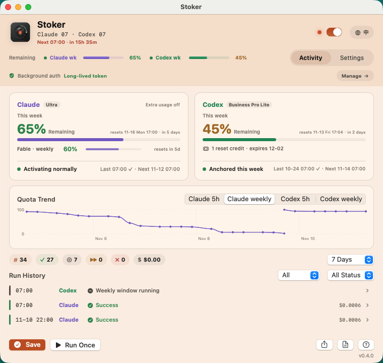
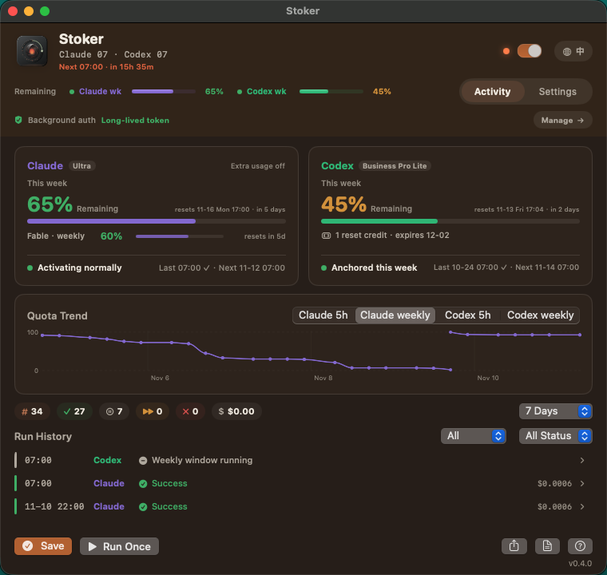
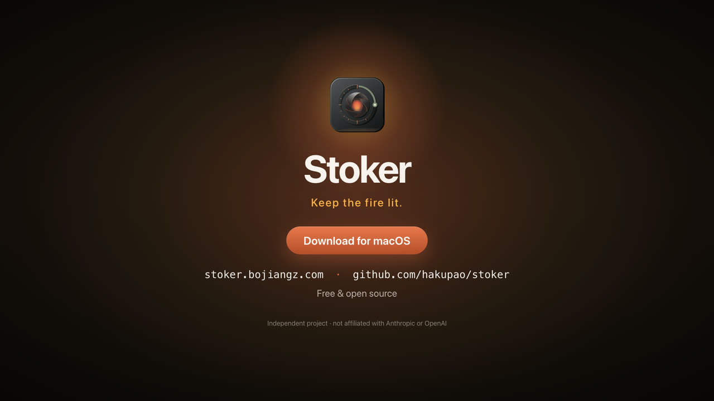
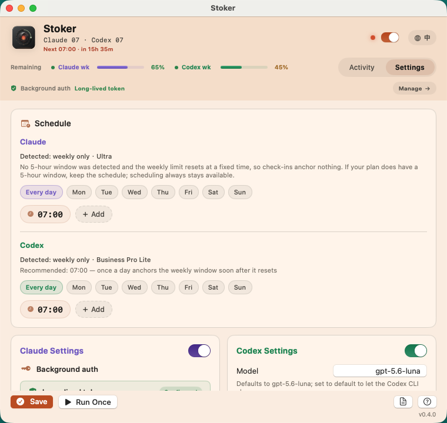
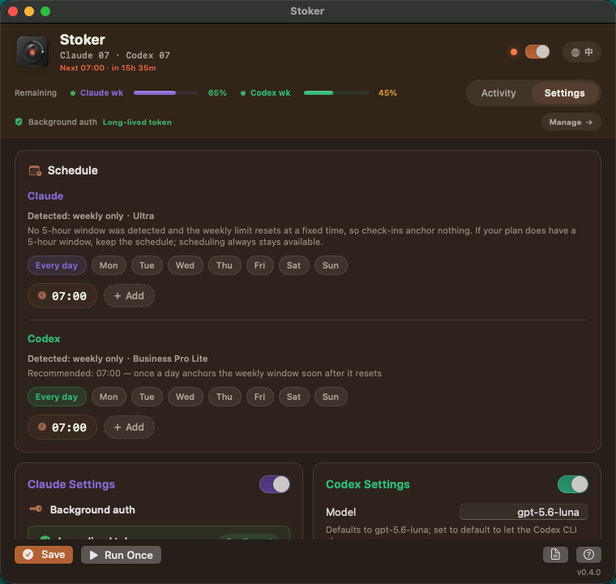
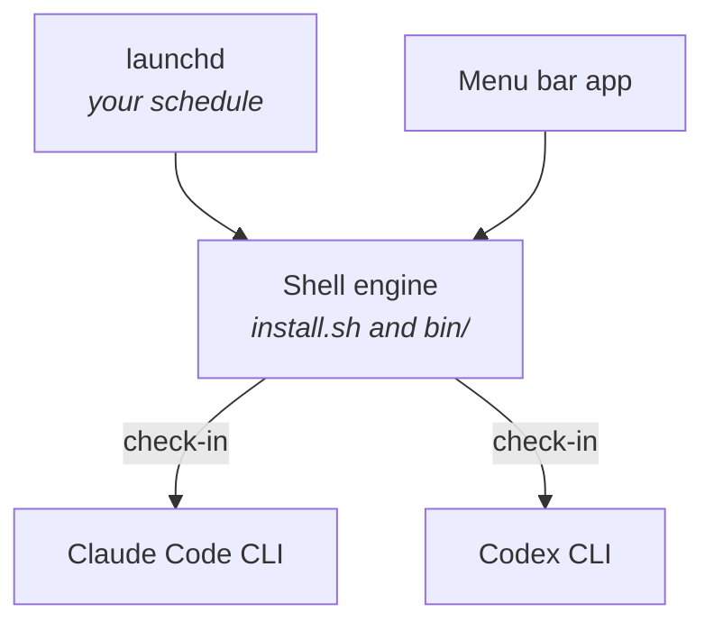

<div align="center">

[English](README.md) · [中文](README_CN.md)


# Stoker

**Keep your Claude Code & Codex usage windows lit — on a schedule you choose.**

[](https://github.com/hakupao/stoker/actions/workflows/ci.yml)
[](LICENSE)
[](#requirements)
[](CHANGELOG.md)
[](https://stoker.bojiangz.com/)

[Website](https://stoker.bojiangz.com/) · [Download](https://github.com/hakupao/stoker/releases/latest) · [Install](#install) · [Configuration](#configuration) · [Reference](REFERENCE.md)

<br/>

<table>
  <tr>
    <td align="center"><sub><b>Activity · Light</b></sub><br/></td>
    <td align="center"><sub><b>Activity · Dark</b></sub><br/></td>
  </tr>
</table>

<a href="https://stoker.bojiangz.com/#film"></a><br/>
<sub>▶ <a href="https://stoker.bojiangz.com/#film">Watch the 40-second film</a> · <a href="docs/assets/stoker-promo-en.mp4">MP4</a></sub>

</div>

## What it does

Many Claude and Codex plans limit how much you can use within a 5-hour window. The window
starts with your first message and resets 5 hours later.

Say you start work at 9:00. Your limit resets at 14:00. If a tiny message had gone out at
7:00, it would reset at 12:00, and you would have a fresh window for the afternoon.

Stoker sends that tiny message for you, at the times you pick. This page calls it a
**check-in**.

- **It runs on your Mac.** macOS `launchd` fires the schedule. Nothing is sent to the author.
- **Each tool has its own schedule.** Claude and Codex each get their own times and days.
- **Check-ins are tiny and read-only.** Claude replies `READY`. Codex reads one small file in
  its own folder. Your real projects are never opened.
- **Everything is logged.** Each run, its token use, and your quota before and after.
- **It skips when there is no point.** A tool whose quota is used up is not sent a check-in.

You can use it from the terminal, from the menu bar app, or both. They share one engine and
one config file.

## Does your plan need it?

Not every plan has a 5-hour window. Stoker reads the windows your account reports and
recommends a schedule for them. As of November 2026:

| Tool | Plan | 5-hour window | Weekly limit |
| --- | --- | --- | --- |
| Claude | Free, Pro, Max, Team*, Enterprise (seat-based) | Yes | Yes, resets at a fixed time |
| Claude | Ultra | No (a temporary one until the account is verified) | Yes, resets at a fixed time |
| Codex | Plus, Business (standard seat) | Yes* | Yes |
| Codex | Pro, Business (premium seat)* | No | Yes, starts on first use* |

\* Not confirmed by an official page. Plans change often, so treat the table as a guide.

A window starts when you first use it. A limit that resets at a fixed time does so whatever
you do. What this means for you:

- **You have a 5-hour window.** Stoker is most useful here. The default schedule
  (`07:00, 12:00, 17:00, 22:00`) keeps a window open through the day.
- **You only have a Codex weekly window.** It starts on first use, so one check-in a day is enough.
- **You only have a Claude weekly limit.** It resets at a fixed time, so check-ins change
  nothing. Stoker tells you so, and leaves the choice to you.

To see what Stoker detected for your account, open the app's Settings or run
`./install.sh recommend`. Stoker only recommends. It never changes or turns off a schedule
by itself.

## Requirements

- macOS 14 or later.
- The Claude Code CLI, the Codex CLI, or both, signed in with your subscription.
- `jq`. The menu bar app includes it. For the command line, `brew install jq`.
- Optional, for quota tracking: Node.js (Codex) and the oh-my-claudecode plugin (Claude).
  Without the plugin, set `CLAUDE_STATUS_SOURCE=native`.

The Claude and ChatGPT desktop apps do not include these CLIs. Install them separately:

```sh
curl -fsSL https://claude.ai/install.sh | bash          # then run `claude` once to sign in
curl -fsSL https://chatgpt.com/codex/install.sh | sh    # then run `codex` once to sign in
```

Using only one tool? Set `ACTIVATION_TOOL=claude` or `ACTIVATION_TOOL=codex`.

## Install

### Menu bar app

1. Download `stoker-gui-<version>.dmg` from the
   [latest release](https://github.com/hakupao/stoker/releases/latest).
2. Drag `Stoker.app` into `Applications` and open it from there.
3. macOS blocks the first launch because the app is not notarized. Approve it once in
   **System Settings › Privacy & Security › Open Anyway**. On macOS 14, right-click the app
   and choose **Open** instead. [INSTALL.md](INSTALL.md) has the exact steps.
4. Open **Settings...** from the menu bar icon, pick your times, and click **Save**.
5. In **Settings › Background auth**, click **Configure token**. Scheduled Claude runs need
   it. [Why](#sign-in-for-scheduled-claude-runs).

The schedule keeps running when the app is closed.

### Command line

```sh
git clone https://github.com/hakupao/stoker.git
cd stoker
cp .env.example .env
./install.sh check      # are the tools installed?
./install.sh dry-run    # show what would be sent, send nothing
./install.sh install    # load the schedule
```

Then set up [sign-in for scheduled Claude runs](#sign-in-for-scheduled-claude-runs).

### Sign-in for scheduled Claude runs

By default a scheduled run reuses the sign-in from your own Claude Code sessions. That
sign-in is short-lived, so a scheduled run can fail with
`401 Invalid authentication credentials`. A long-lived token fixes this:

```sh
claude setup-token    # opens a browser and prints sk-ant-oat01-...
```

Put the token in `.env` as `CLAUDE_CODE_OAUTH_TOKEN="sk-ant-oat01-..."`. It uses your existing
subscription and adds no API charges. The app's **Configure token** button does all of this
for you.

### Upgrading

Replace the app or pull the new code. Then run `./install.sh install` once, or turn the
schedule off and on in the app. [CHANGELOG.md](CHANGELOG.md) says when a release needs more.

## Everyday use

| Command | What it does | Sends a check-in? |
| --- | --- | :---: |
| `./install.sh status` | Shows whether the schedule is loaded | No |
| `./install.sh recommend` | Shows your detected windows and the schedule that fits them | No |
| `./install.sh quota` | Records your current quota | No |
| `./install.sh dry-run` | Prints the exact commands a run would use | No |
| `./install.sh check` | Checks that the required tools are installed | No |
| `./install.sh run-now` | Sends one check-in now to each enabled tool. Run `install` first | **Yes** |
| `./install.sh install` | Loads or reloads the schedule | No¹ |
| `./install.sh uninstall` | Removes the schedule | No |

¹ `install` sends nothing itself, but the schedule it loads will.

To confirm it is working:

```sh
./install.sh status              # "not running" between runs is normal
tail -f logs/activation.log      # plain-text run history
tail -n 20 logs/usage.jsonl | jq # one record per tool per run
```

A skipped run is recorded with `skipped: true` and a reason. See
[Logs](REFERENCE.md#logs) for the full list of files.

## Configuration

Settings live in `.env`. The app reads and writes the same file, so there is one source of
truth. These are the settings most people change:

| Variable | What it sets | Default |
| --- | --- | --- |
| `CLAUDE_SCHEDULE_TIMES` | Claude's times, as comma-separated `HH:MM` | `SCHEDULE_TIMES` |
| `CODEX_SCHEDULE_TIMES` | Codex's times | `SCHEDULE_TIMES` |
| `CLAUDE_SCHEDULE_DAYS` | Claude's days, such as `mon,tue,wed`. Empty means every day | every day |
| `CODEX_SCHEDULE_DAYS` | Codex's days | every day |
| `SCHEDULE_TIMES` | Times for a tool that has none of its own | `07:00,12:00,17:00,22:00` |
| `ACTIVATION_TOOL` | Which tools run: `all`, `claude`, or `codex` | `all` |
| `CLAUDE_CODE_OAUTH_TOKEN` | Long-lived sign-in token for scheduled Claude runs | unset |
| `CODEX_MODEL` | Model for Codex check-ins. `default` lets the Codex CLI choose | `gpt-5.6-luna` |
| `CODEX_ACTIVATE_ONLY_WHEN_IDLE` | `1` skips Codex while its window is already running | `1` |
| `KEEP_AWAKE_MODE` | Keep the Mac awake during a run: `off`, `during`, or `always` | `off` |

After changing a schedule or `ACTIVATION_TOOL` by hand, run `./install.sh install` again. The
app does this for you when you click Save.

[REFERENCE.md](REFERENCE.md#configuration) lists every variable.

### The Mac must be awake

`launchd` does not run a job while the Mac is asleep. On wake it runs a missed job once, not
once per missed time. `KEEP_AWAKE_MODE` keeps the Mac awake during a run but cannot wake it.

For reliable times, keep the Mac awake at those times, or have macOS wake it shortly before
one. `pmset repeat` holds a single wake time:

```sh
sudo pmset repeat wakeorpoweron MTWRFSU 06:58:00
```

## Menu bar app

The app is a front end for the same engine. It has no scheduler of its own.

- **Activity.** A card per tool with your quota, when it resets, and whether check-ins are
  healthy. Below: a quota trend chart and the run history, which you can filter and export
  to CSV.
- **Settings.** Times and days for each tool, the windows Stoker detected with a
  **Use recommended** button, **Background auth**, and the **Advanced** options.
- **Menu bar icon.** The flame shows a red dot when a tool needs attention.
- **Environment Check.** Shows which required and optional tools are installed.
- **English and Chinese**, light and dark.

<div align="center">
<table>
  <tr>
    <td align="center"><sub><b>Settings · Light</b></sub><br/></td>
    <td align="center"><sub><b>Settings · Dark</b></sub><br/></td>
  </tr>
</table>
</div>

The health states are explained in [REFERENCE.md](REFERENCE.md#health-states).

## What it costs

On a subscription you are not billed for check-ins. They come out of your plan's usage, like
your own messages. Stoker strips each CLI down to the minimum so that share stays small.

| Tool | Per check-in | Per month at 4 a day |
| --- | --- | --- |
| Claude | About 1.6K input tokens, worth ≈ $0.0025 | Worth ≈ $0.30 |
| Codex | About 38K input tokens, about 55% of them cache reads | No dollar figure is reported |

The dollar figures are what Claude Code reports the same tokens would cost at API prices.
Without the trimming, a Claude check-in would load about 40K tokens, worth about $0.15. The
flags that do the trimming are listed in [REFERENCE.md](REFERENCE.md#how-check-ins-stay-small).

## How it works



Each run does the same things in order:

1. Read `.env` and take a lock, so two runs never overlap.
2. Check quota. Skip a tool whose quota is used up.
3. Send one check-in to each enabled tool.
4. Record token use in `logs/usage.jsonl`.
5. Record quota again in `logs/status.jsonl` and release the lock.

Both CLIs run inside Stoker's own folder, never inside your projects.
[REFERENCE.md](REFERENCE.md#how-a-run-works) has the details.

## Safety

- `dry-run`, `quota`, `check`, `status`, and `recommend` never send a check-in.
- `run-now` and scheduled runs send one check-in per enabled tool, and only when quota is
  available.
- Claude runs with no tools, no MCP servers, no slash commands, and no saved session.
- Codex runs in a read-only sandbox, inside the small `codex-probe/` folder.
- By default Stoker updates your Codex CLI before a Codex check-in. Set `CODEX_AUTO_UPDATE=0`
  to turn that off.

## Uninstall

From a clone:

```sh
./install.sh uninstall
```

Then delete the folder.

With the app: turn the schedule off with the switch at the top of the window, then delete
`Stoker.app`. If you already deleted the app, the schedule is still loaded. Remove it with:

```sh
~/Library/Application\ Support/Stoker/stoker/install.sh uninstall
```

The app's settings and logs stay in `~/Library/Application Support/Stoker`. Delete that
folder too if you want them gone.

## More

- [INSTALL.md](INSTALL.md): step-by-step installation.
- [REFERENCE.md](REFERENCE.md): every setting, the health states, and how a run works.
- [CHANGELOG.md](CHANGELOG.md): release history.
- [CONTRIBUTING.md](CONTRIBUTING.md): development and release notes. Run
  `./scripts/validate.sh` before sending a change.
- [SECURITY.md](SECURITY.md): how to report a vulnerability.

## Disclaimer

Stoker is an independent open-source project. It is **not affiliated with, endorsed by, or
sponsored by Anthropic, OpenAI, or Apple**. Their names are trademarks of their owners and
are used here only to identify the tools Stoker works with.

Stoker sends automated prompts on your behalf and uses real quota. **You are solely responsible**
for following the terms and usage policies of Anthropic and OpenAI, and for any resulting
costs or account actions. The software is provided "as is", without warranty. See
[DISCLAIMER.md](DISCLAIMER.md) for the full text.

## License

MIT. See [LICENSE](LICENSE).
