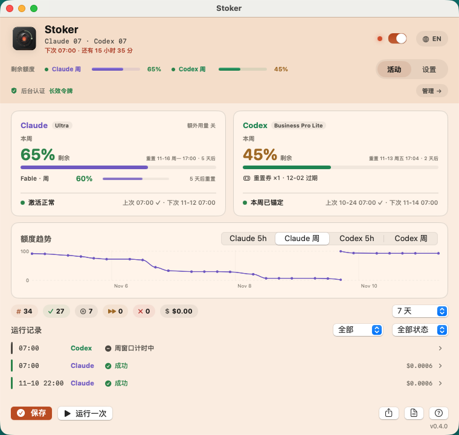
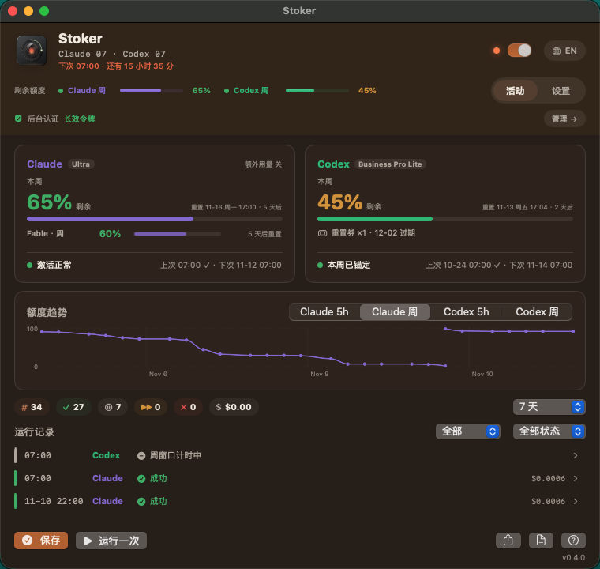
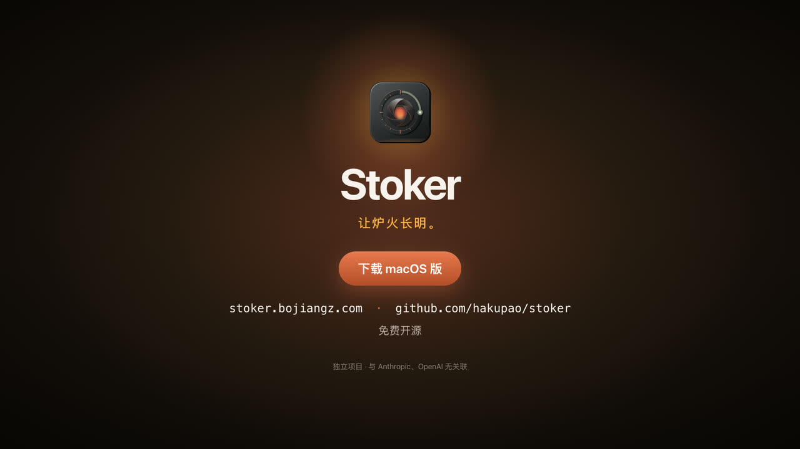
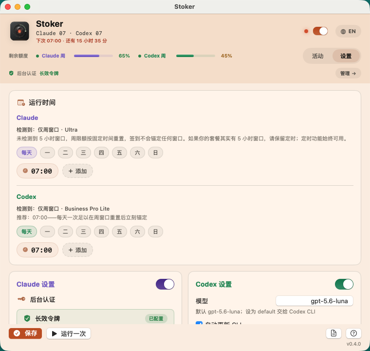
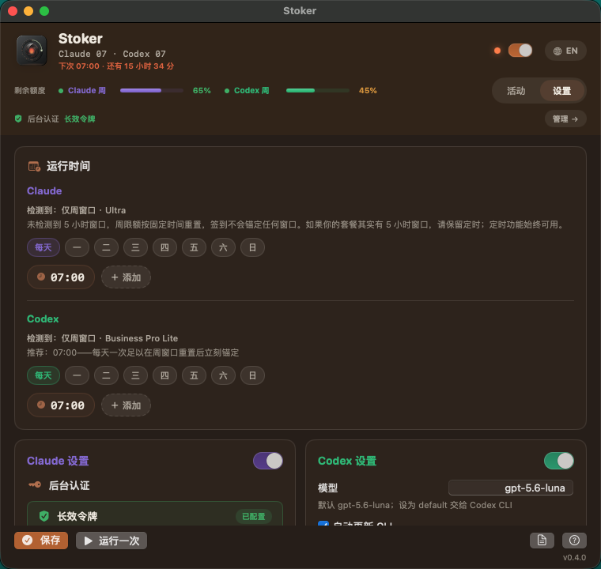
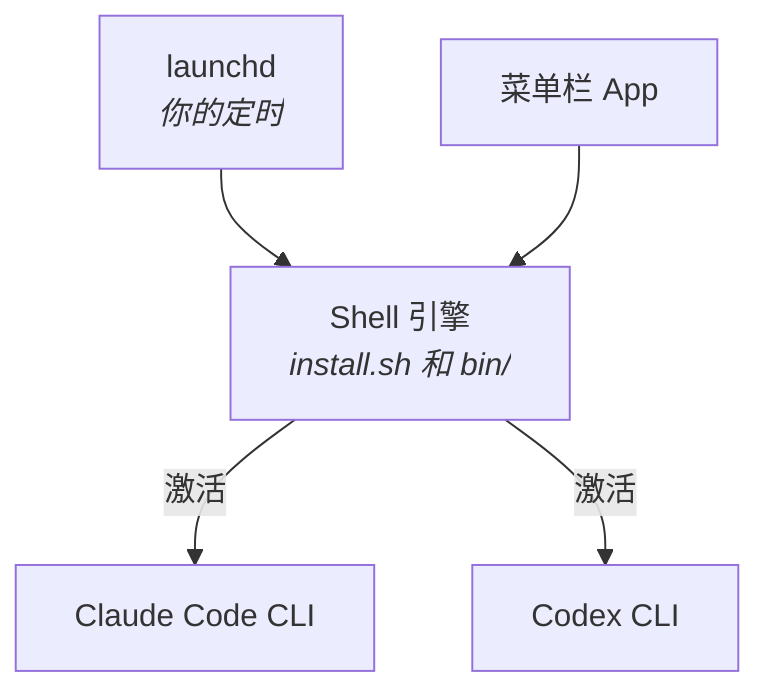

<div align="center">

[English](README.md) · [中文](README_CN.md)


# Stoker

**按你的作息，把 Claude Code 和 Codex 的用量窗口一直「续上火」。**

[](https://github.com/hakupao/stoker/actions/workflows/ci.yml)
[](LICENSE)
[](#环境要求)
[](CHANGELOG.md)
[](https://stoker.bojiangz.com/)

[网站](https://stoker.bojiangz.com/) · [下载](https://github.com/hakupao/stoker/releases/latest) · [安装](#安装) · [配置](#配置) · [参考文档](REFERENCE_CN.md)

<br/>

<table>
  <tr>
    <td align="center"><sub><b>活动 · 浅色</b></sub><br/></td>
    <td align="center"><sub><b>活动 · 深色</b></sub><br/></td>
  </tr>
</table>

<a href="https://stoker.bojiangz.com/#film"></a><br/>
<sub>▶ <a href="https://stoker.bojiangz.com/#film">观看 40 秒宣传片</a> · <a href="docs/assets/stoker-promo-zh.mp4">MP4</a></sub>

</div>

## 它能做什么

很多 Claude 和 Codex 套餐会限制你在一个 5 小时窗口里能用多少。窗口从你发出第一条消息时开始，5 小时后重置。

假设你 9:00 开始工作，额度就要到 14:00 才重置。如果 7:00 已经发出过一条很小的消息，额度会在 12:00 重置。这样下午你就有一个全新的窗口。

Stoker 会在你选定的时间，替你发出这条小消息。本文把这条消息叫作一次**激活**。

- **在你自己的 Mac 上运行。** 定时由 macOS `launchd` 触发。不会向作者发送任何数据。
- **每个工具各有自己的定时。** Claude 和 Codex 分别设置时间和星期。
- **激活很小，并且只读。** Claude 只回复 `READY`。Codex 只读取它自己目录里的一个小文件。你的真实项目永远不会被打开。
- **一切都有记录。** 包括每次运行、它用掉的 token，以及运行前后的额度。
- **没有意义时会跳过。** 额度已经用尽的工具，不会收到激活。

你可以在终端里用，也可以用菜单栏 App，或者两者一起用。它们共用同一个引擎和同一个配置文件。

## 你的套餐需要它吗？

不是每个套餐都有 5 小时窗口。Stoker 会读取你的账号上报的窗口，并据此推荐运行时间。截至 2026 年 11 月：

| 工具 | 套餐 | 5 小时窗口 | 周限额 |
| --- | --- | --- | --- |
| Claude | Free、Pro、Max、Team*、Enterprise（按席位） | 有 | 有，在固定时间重置 |
| Claude | Ultra | 没有（账号验证完成前有一个临时的） | 有，在固定时间重置 |
| Codex | Plus、Business（标准席位） | 有* | 有 |
| Codex | Pro、Business（高级席位）* | 没有 | 有，从首次使用时开始* |

\* 没有官方页面确认。套餐经常变化，这张表仅供参考。

窗口在你第一次使用时开始。在固定时间重置的限额，不管你做什么都会按时重置。按你的情况：

- **你有 5 小时窗口。** 这时 Stoker 最有用。默认定时（`07:00, 12:00, 17:00, 22:00`）能让窗口一整天都开着。
- **你只有 Codex 周窗口。** 它从首次使用时开始，所以每天激活一次就够了。
- **你只有 Claude 周限额。** 它在固定时间重置，所以激活改变不了什么。Stoker 会告诉你这一点，要不要用由你决定。

想看 Stoker 为你的账号检测到了什么，可以打开 App 的设置，或者运行 `./install.sh recommend`。Stoker 只给建议。它从不自行修改或关闭定时。

## 环境要求

- macOS 14 或更新版本。
- Claude Code CLI、Codex CLI，或者两者都装，并已用你的订阅登录。
- `jq`。菜单栏 App 已经自带。用命令行时可以 `brew install jq`。
- 可选，用于跟踪额度：Node.js（Codex 用）和 oh-my-claudecode 插件（Claude 用）。没有这个插件时，设置 `CLAUDE_STATUS_SOURCE=native`。

Claude 和 ChatGPT 的桌面 App 不包含这些 CLI，需要单独安装：

```sh
curl -fsSL https://claude.ai/install.sh | bash          # 装好后运行一次 `claude` 登录
curl -fsSL https://chatgpt.com/codex/install.sh | sh    # 装好后运行一次 `codex` 登录
```

只用其中一个工具？设置 `ACTIVATION_TOOL=claude` 或 `ACTIVATION_TOOL=codex`。

## 安装

### 菜单栏 App

1. 从[最新版本](https://github.com/hakupao/stoker/releases/latest)下载 `stoker-gui-<version>.dmg`。
2. 把 `Stoker.app` 拖进 `Applications`，然后从那里打开它。
3. App 没有经过 Apple 公证，所以第一次打开会被 macOS 拦下。在 **系统设置 › 隐私与安全性 › 仍要打开** 里放行一次即可。macOS 14 上改为右键点 App，选择 **打开**。具体步骤见 [INSTALL_CN.md](INSTALL_CN.md)。
4. 从菜单栏图标打开 **设置...**，选好时间，点击 **保存**。
5. 在 **设置 › 后台认证** 里点击 **配置长效令牌**。定时运行 Claude 需要它。[原因见这里](#定时运行-claude-的登录)。

App 关闭后，定时仍会继续运行。

### 命令行

```sh
git clone https://github.com/hakupao/stoker.git
cd stoker
cp .env.example .env
./install.sh check      # 工具都装好了吗？
./install.sh dry-run    # 显示会发送什么，但不发送
./install.sh install    # 加载定时
```

然后设置[定时运行 Claude 的登录](#定时运行-claude-的登录)。

### 定时运行 Claude 的登录

默认情况下，定时运行会沿用你平时在终端里登录的 Claude Code。这个登录的有效期很短，所以定时运行可能失败，报错 `401 Invalid authentication credentials`。长效令牌可以解决这个问题：

```sh
claude setup-token    # 打开浏览器，并打印出 sk-ant-oat01-...
```

把令牌写进 `.env`：`CLAUDE_CODE_OAUTH_TOKEN="sk-ant-oat01-..."`。它使用你现有的订阅，不会产生 API 费用。App 里的 **配置长效令牌** 按钮会替你完成这些步骤。

### 升级

替换 App，或者拉取新代码。然后运行一次 `./install.sh install`，或者在 App 里把定时关掉再打开。某个版本如果还需要别的步骤，[CHANGELOG.md](CHANGELOG.md) 会写明。

## 日常使用

| 命令 | 作用 | 会发送激活吗？ |
| --- | --- | :---: |
| `./install.sh status` | 显示定时是否已加载 | 否 |
| `./install.sh recommend` | 显示检测到的窗口，以及适合它们的运行时间 | 否 |
| `./install.sh quota` | 记录当前额度 | 否 |
| `./install.sh dry-run` | 打印一次运行会用到的完整命令 | 否 |
| `./install.sh check` | 检查必需的工具是否已安装 | 否 |
| `./install.sh run-now` | 立刻给每个启用的工具发送一次激活。要先运行 `install` | **是** |
| `./install.sh install` | 加载或重新加载定时 | 否¹ |
| `./install.sh uninstall` | 移除定时 | 否 |

¹ `install` 本身不发送任何内容，但它加载的定时会发送。

确认它在正常工作：

```sh
./install.sh status              # 两次运行之间显示 "not running" 是正常的
tail -f logs/activation.log      # 纯文本的运行记录
tail -n 20 logs/usage.jsonl | jq # 每个工具每次运行一条记录
```

被跳过的运行会记为 `skipped: true`，并带上原因。完整的文件列表见[日志](REFERENCE_CN.md#日志)。

## 配置

设置都在 `.env` 里。App 读写的也是这个文件，所以设置只有一份。下面是大多数人会改的设置：

| 变量 | 作用 | 默认值 |
| --- | --- | --- |
| `CLAUDE_SCHEDULE_TIMES` | Claude 的时间，逗号分隔的 `HH:MM` | `SCHEDULE_TIMES` |
| `CODEX_SCHEDULE_TIMES` | Codex 的时间 | `SCHEDULE_TIMES` |
| `CLAUDE_SCHEDULE_DAYS` | Claude 的星期，例如 `mon,tue,wed`。留空表示每天 | 每天 |
| `CODEX_SCHEDULE_DAYS` | Codex 的星期 | 每天 |
| `SCHEDULE_TIMES` | 工具没有设置自己的时间时，使用这组时间 | `07:00,12:00,17:00,22:00` |
| `ACTIVATION_TOOL` | 运行哪些工具：`all`、`claude` 或 `codex` | `all` |
| `CLAUDE_CODE_OAUTH_TOKEN` | 定时运行 Claude 用的长效登录令牌 | 未设置 |
| `CODEX_MODEL` | Codex 激活用的模型。设为 `default` 则由 Codex CLI 自己选 | `gpt-5.6-luna` |
| `CODEX_ACTIVATE_ONLY_WHEN_IDLE` | `1` 表示 Codex 的窗口已在计时就跳过 | `1` |
| `KEEP_AWAKE_MODE` | 运行期间让 Mac 保持唤醒：`off`、`during` 或 `always` | `off` |

手动修改定时或 `ACTIVATION_TOOL` 后，要重新运行 `./install.sh install`。在 App 里点击 **保存** 时，App 会替你做这一步。

所有变量见 [REFERENCE_CN.md](REFERENCE_CN.md#配置)。

### Mac 必须保持唤醒

Mac 睡眠时，`launchd` 不会运行任务。唤醒后，错过的任务只补跑一次，不会每个错过的时间都跑一次。`KEEP_AWAKE_MODE` 能让 Mac 在运行期间保持唤醒，但不能把 Mac 唤醒。

想让时间准确，就让 Mac 在这些时间保持唤醒，或者让 macOS 在某个时间前不久把它唤醒。`pmset repeat` 只能设一个唤醒时间：

```sh
sudo pmset repeat wakeorpoweron MTWRFSU 06:58:00
```

## 菜单栏 App

App 是同一个引擎的操作界面。它自己不负责定时。

- **活动。** 每个工具一张卡片，显示额度、重置时间，以及激活是否正常。下方是「额度趋势」图和「运行记录」。运行记录可以筛选，也可以导出为 CSV。
- **设置。** 每个工具的时间和星期、Stoker 检测到的窗口和 **套用推荐** 按钮、「后台认证」，以及「高级设置」。
- **菜单栏图标。** 某个工具需要处理时，火苗图标上会出现一个小红点。
- **环境检查。** 显示哪些必需和可选的工具已经安装。
- **中英双语**，支持浅色和深色。

<div align="center">
<table>
  <tr>
    <td align="center"><sub><b>设置 · 浅色</b></sub><br/></td>
    <td align="center"><sub><b>设置 · 深色</b></sub><br/></td>
  </tr>
</table>
</div>

健康状态的含义见 [REFERENCE_CN.md](REFERENCE_CN.md#健康状态)。

## 费用

用订阅的话，激活不会另外收费。它和你自己发的消息一样，从套餐用量里扣。Stoker 把每个 CLI 精简到最低限度，让这部分用量很小。

| 工具 | 每次激活 | 每天 4 次，每月合计 |
| --- | --- | --- |
| Claude | 约 1.6K 输入 token，折合 ≈ $0.0025 | 折合 ≈ $0.30 |
| Codex | 约 38K 输入 token，其中约 55% 是缓存读取 | 没有上报美元金额 |

这里的美元金额，是 Claude Code 报告的同样 token 按 API 价格计算的费用。不做精简的话，一次 Claude 激活会加载约 40K token，折合约 $0.15。负责精简的参数见 [REFERENCE_CN.md](REFERENCE_CN.md#激活如何保持精简)。

## 工作原理



每次运行都按顺序做这几件事：

1. 读取 `.env` 并加锁，保证两次运行不会重叠。
2. 检查额度。额度已用尽的工具会被跳过。
3. 给每个启用的工具发送一次激活。
4. 把 token 用量记到 `logs/usage.jsonl`。
5. 再记录一次额度到 `logs/status.jsonl`，然后释放锁。

两个 CLI 都在 Stoker 自己的目录里运行，从不进入你的项目。详情见 [REFERENCE_CN.md](REFERENCE_CN.md#一次运行的流程)。

## 安全

- `dry-run`、`quota`、`check`、`status` 和 `recommend` 从不发送激活。
- `run-now` 和定时运行会给每个启用的工具发送一次激活，并且只在还有额度时发送。
- Claude 运行时不带任何工具、MCP 服务器和斜杠命令，也不保存会话。
- Codex 在只读沙箱里运行，范围限定在很小的 `codex-probe/` 目录。
- 默认情况下，Stoker 会在 Codex 激活前更新你的 Codex CLI。设置 `CODEX_AUTO_UPDATE=0` 可以关闭。

## 卸载

如果用的是克隆目录：

```sh
./install.sh uninstall
```

然后删除这个文件夹。

如果用的是 App：先用窗口顶部的开关关闭定时，再删除 `Stoker.app`。如果已经先删了 App，定时仍然处于加载状态。用下面的命令移除：

```sh
~/Library/Application\ Support/Stoker/stoker/install.sh uninstall
```

App 的设置和日志留在 `~/Library/Application Support/Stoker`。想彻底清除，就把这个文件夹也删掉。

## 更多

- [INSTALL_CN.md](INSTALL_CN.md)：分步安装说明。
- [REFERENCE_CN.md](REFERENCE_CN.md)：所有设置、健康状态，以及一次运行的流程。
- [CHANGELOG.md](CHANGELOG.md)：版本历史。
- [CONTRIBUTING.md](CONTRIBUTING.md)：开发与发布说明。提交改动前请运行 `./scripts/validate.sh`。
- [SECURITY.md](SECURITY.md)：如何报告安全漏洞。

## 免责声明

Stoker 是一个独立的开源项目。它**与 Anthropic、OpenAI、Apple 没有任何关联，也未获得它们的认可或赞助**。这些名称是各自所有者的商标，这里只用来说明 Stoker 配合哪些工具使用。

Stoker 会代你自动发送消息，并消耗真实额度。**你需要自行负责**遵守 Anthropic 和 OpenAI 的条款与使用政策，并承担由此产生的任何费用，以及账号被限制或封禁等后果。本软件按「原样」提供，不附带任何保证。完整条款见 [DISCLAIMER.md](DISCLAIMER.md)。

## 许可证

MIT。见 [LICENSE](LICENSE)。
